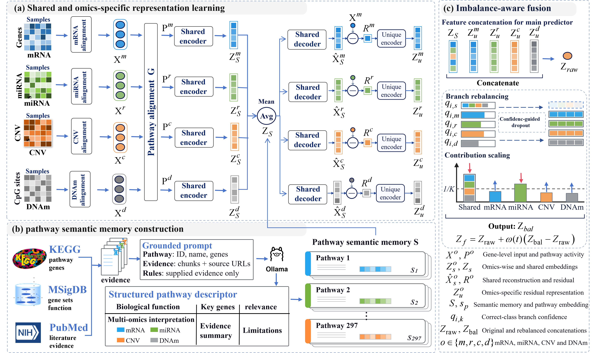

# PathDUET

**Disentangle to Unify: Fusing Internal Data and External Semantics via Pathway Disentanglement for Imbalanced Multi-Omics**

PathDUET integrates mRNA, miRNA, DNA methylation and copy-number variation using shared pathway representations, omics-specific residual representations, fixed pathway semantic memory and branch-aware fusion.



## Code and datasets

- **Code:** [https://github.com/zppaper/PathDUET](https://github.com/zppaper/PathDUET)
- **Archived code and datasets:** [https://zenodo.org/records/23834883](https://zenodo.org/records/23834883)
- **Archive DOI:** [https://doi.org/10.5281/zenodo.23834883](https://doi.org/10.5281/zenodo.23834883)
- **Download:** [PathDUET_code_and_datasets.rar](https://zenodo.org/records/23834883/files/PathDUET_code_and_datasets.rar)

## Directory setup

Download the code and extract `PathDUET_code_and_datasets.rar`. Arrange the code, processed datasets and fixed pathway resources as follows:

```text
PathDUET/
├── README.md
├── requirements.txt
├── assets/
│   └── figure2.png
├── train.py
├── predict.py
├── evaluate.py
├── pathduet/
│   ├── model.py
│   ├── losses.py
│   ├── training.py
│   ├── data.py
│   ├── metrics.py
│   ├── runtime.py
│   ├── constants.py
│   └── __init__.py
└── datasets/
    ├── stage/
    │   ├── COAD/
    │   ├── KIRP/
    │   ├── THCA/
    │   └── UCS/
    ├── resources/
    │   ├── gene_pathway.csv
    │   └── semantic_memory.csv
    └── README.md
```

Each cohort directory contains `mRNA.csv`, `miRNA.csv`, `dnam_gene.csv`, `cnv_gene.csv`, `label.csv` and `splits/`. Place `datasets/` at the repository root, alongside `train.py`, or specify its location with `--data /path/to/datasets`.

Molecular matrices have samples in rows, `sample_id` first, and 8,074 ordered gene columns. Each seed directory contains five split CSVs and their saved training-fold scaler CSVs. The four cohorts share fixed resources for 297 pathways. All model inputs and semantic resources are local CSV files; no external language-model service is required.

## Run the main experiments

The reference environment uses Python 3.10.19 and PyTorch 2.7.0 with CUDA 12.8. From the repository root, install dependencies:

```bash
python -m pip install torch==2.7.0 --index-url https://download.pytorch.org/whl/cu128
python -m pip install -r requirements.txt
```

Use a PyTorch build suitable for your hardware. The scripts automatically select CUDA when available, otherwise CPU; use `--device cpu` to select CPU explicitly.

Cancer-stage classification on COAD, KIRP, THCA and UCS:

```bash
python train.py --output results
```

This runs seeds 1028, 2024 and 3407 with five outer folds per cohort: 60 folds in total. All 39 stage hyperparameters are defined as `STAGE_PARAMETERS` in `train.py`. Defaults include 120 epochs, batch size 32, learning rate 0.0005, weight decay 0.0001 and validation-AUC checkpoint selection with patience 20.

To run one cohort and seed:

```bash
python train.py --cohorts COAD --seeds 1028 --output results
```

For a short CPU check:

```bash
python train.py --cohorts COAD --seeds 1028 --smoke --output checks_cpu --device cpu
```
