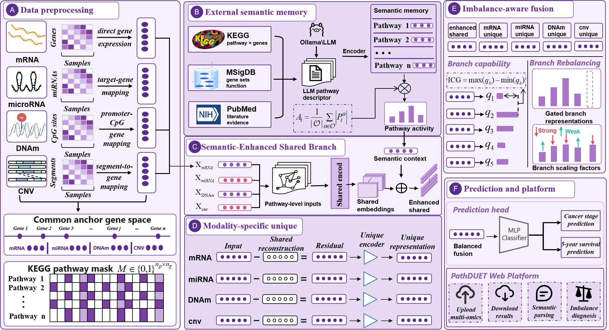

# PathDUET

PathDUET is a pathway-driven multi-omics disentanglement framework for clinical prediction. It is designed to integrate heterogeneous omics profiles, external pathway semantic knowledge, and imbalance-aware multi-branch fusion in a unified model.

## Overview

Multi-omics integration is important for cancer stage classification and survival prediction, but conventional representation learning methods often learn abstract latent features that are difficult to connect with biological mechanisms. PathDUET addresses this limitation by mapping multiple omics modalities into a unified KEGG pathway space and decomposing multi-omics signals into pathway-shared and omics-specific components.

PathDUET takes four omics modalities as input:

- mRNA expression
- miRNA expression
- DNA methylation
- Copy number variation

Each modality is first projected into a common anchor-gene space and then mapped to pathway-level representations using KEGG pathway gene sets. The shared branch captures cross-omics pathway-level regulatory signals, while modality-specific residual branches preserve complementary information that is not explained by the shared pathway representation.

To further improve biological interpretability, PathDUET incorporates an external pathway semantic memory constructed from pathway knowledge sources such as KEGG, MSigDB, and PubMed evidence. For each sample, pathway activity is used to retrieve sample-specific semantic context, which is fused into the shared pathway representation.

PathDUET also introduces an imbalance-aware fusion strategy. This module estimates branch-level contribution and confidence, then adaptively calibrates the fusion process to reduce dominance by strong omics branches and promote the participation of weaker but complementary branches.

## Model Architecture

PathDUET consists of three main components:

1. **Pathway-anchored disentanglement**  
   Multi-omics profiles are projected into KEGG pathway space. A shared pathway branch learns cross-omics common signals, and modality-specific residual branches learn private omics information.

2. **External pathway semantic enhancement**  
   A pathway semantic memory provides external biological knowledge. Sample-specific pathway activity is used to retrieve semantic context and enhance the shared pathway representation.

3. **Imbalance-aware fusion**  
   Branch confidence and contribution are estimated during training. The model dynamically rebalances branch representations to reduce modality dominance and improve robust multi-omics fusion.

## Tasks

PathDUET supports binary clinical prediction tasks, including:

- Cancer stage classification
- Five-year survival status prediction

## Repository Status

This repository is currently being prepared for partial open-source release. The first release will provide core data utilities and gradually add the model, training pipeline, semantic memory construction, and reproduction scripts.
